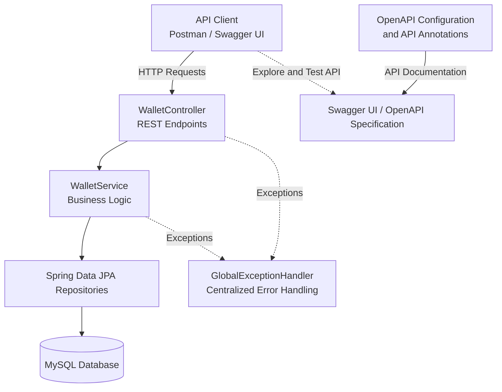

# Digital Wallet & P2P Payment API

A backend REST API built with **Java 21, Spring Boot, and MySQL** for digital wallet management and peer-to-peer (P2P) money transfers.

The project demonstrates transactional processing, pessimistic database locking, idempotency handling, ledger-style transaction records, request validation, and wallet lifecycle management.

[](https://www.oracle.com/java/)
[](https://spring.io/projects/spring-boot)
[](https://www.mysql.com/)
[](https://restfulapi.net/)

## Features

- **Wallet management:** Create wallets with unique 12-digit account numbers.
- **Balance inquiry:** Retrieve wallet details and current balances.
- **P2P transfers:** Transfer money between wallets using transactional processing.
- **Concurrency control:** Acquire pessimistic write locks on participating wallets in a consistent order to help reduce deadlock risk.
- **Idempotency:** Use an idempotency key and request hash to identify repeated transfer requests.
- **Transaction ledger:** Store debit and credit entries with a shared reference ID and before/after balance snapshots.
- **Transaction history:** Retrieve paginated transaction records.
- **Wallet lifecycle management:** Activate, freeze, and close wallets according to application rules.
- **Request validation:** Validate wallet details, account numbers, transfer amounts, and pagination parameters.
- **Centralized exception handling:** Return structured JSON error responses.
- **API documentation:** Explore endpoints and execute requests using Swagger UI.

## Tech Stack

| Technology | Purpose |
|---|---|
| Java 21 | Programming language and compilation target |
| Spring Boot 4.1.1 | Application framework |
| Spring Web MVC | REST API development |
| Spring Data JPA | Data access and persistence |
| Hibernate ORM | Object-relational mapping |
| MySQL | Relational database |
| Jakarta Bean Validation | Request validation |
| Springdoc OpenAPI 3.1.1 | OpenAPI specification and documentation integration |
| Swagger UI | Interactive API exploration |
| Maven Wrapper | Build and dependency management |
| JUnit 5 and Spring Boot Test | Automated testing |

## Architecture

The application follows a layered backend architecture built with Spring Boot, Spring Data JPA, and MySQL.




### Main Components

- **Controller layer:** Defines HTTP endpoints and receives incoming requests.
- **Service layer:** Implements wallet creation, balance retrieval, transfers, transaction history, and wallet lifecycle rules.
- **Repository layer:** Provides database access through Spring Data JPA.
- **Entity layer:** Represents users, wallets, transactions, and idempotency records.
- **DTO layer:** Defines request and response structures.
- **Exception handling:** Uses `@RestControllerAdvice` to translate handled application exceptions into structured HTTP error responses.
- **OpenAPI configuration:** Defines the API title, version, and description; controller annotations document endpoints and their responses.

## Transfer Processing and Consistency

A money transfer runs inside a Spring-managed database transaction.

The main processing sequence is:

1. Validate the idempotency key and transfer amount.
2. Reject transfers between the same source and destination wallet.
3. Calculate a SHA-256 hash of the request data.
4. Check whether the idempotency key has already been processed.
5. Locate the source and destination wallets and acquire pessimistic write locks in ascending internal wallet ID order.
6. Verify that both wallets can participate in the transfer and that the source has sufficient funds.
7. Debit the source wallet and credit the destination wallet.
8. Create matching debit and credit ledger entries with the same transfer reference ID.
9. Save the updated wallets, transaction entries, and successful idempotency record within the transaction.

The database transaction is intended to ensure that the balance updates, ledger entries, and idempotency record commit or roll back together.

### Idempotency Behavior

The transfer endpoint requires an `Idempotency-Key` request header.

- Reusing a key with the same request returns the original successful transfer result.
- Reusing a key with a different request returns HTTP `409 Conflict`.
- The key must contain between 1 and 100 characters.
- A database uniqueness constraint prevents multiple committed records from using the same idempotency key.

**Known limitation:** Simultaneous first-time requests using the same key can both pass the initial lookup before either request saves its idempotency record. A database uniqueness violation may then cause the losing transaction to roll back and return HTTP `500 Internal Server Error`. Predictable handling of this concurrency case remains an improvement area.

Consistent lock ordering helps reduce deadlock risk, but it does not eliminate every possible database concurrency failure.

## Wallet and Ledger Rules

- Account numbers contain exactly 12 digits and cannot start with zero.
- Account numbers are generated using `SecureRandom`; a database uniqueness constraint also protects account-number uniqueness.
- Each email address can be associated with only one wallet under the application's current rules.
- Monetary values use Java `BigDecimal`.
- Initial balances cannot be negative.
- Transfer amounts must be positive, contain at most two decimal places, and have no more than 15 integer digits.
- Transfers between the same wallet are rejected.
- Frozen and closed wallets cannot send or receive transfers.
- A wallet can be closed only when its balance is zero.
- A closed wallet cannot be reactivated through the wallet status endpoint.
- Closing a wallet preserves its transaction history.
- Positive initial funding creates an initial credit ledger entry.
- Successful transfers create a debit entry and a credit entry sharing the same reference ID.
- Ledger entries record the transaction type, amount, balance before the transaction, balance after the transaction, description, and timestamp.

Transaction entities use Hibernate `@Immutable`, and their mapped fields are marked non-updatable. This supports an immutable ledger through normal ORM operations; it does not, by itself, prevent direct database modification.

## Prerequisites

Install the following:

- JDK 21 or later
- MySQL
- Git

The project includes Maven Wrapper scripts, so a separate Maven installation is not required.

## Getting Started

### 1. Clone the Repository

```bash
git clone https://github.com/tapankpanda/p2p_digital_wallet.git
cd p2p_digital_wallet
```

### 2. Configure MySQL

Ensure your local MySQL server is running. The example development configuration uses the database name `p2p_digital_wallet`.

The repository includes a development configuration template:

`src/main/resources/application-dev-example.properties`

Copy the template to create your local development configuration.

**Windows — Command Prompt**

```cmd
copy src\main\resources\application-dev-example.properties src\main\resources\application-dev.properties
```

**macOS or Linux**

```bash
cp src/main/resources/application-dev-example.properties src/main/resources/application-dev.properties
```

Open `src/main/resources/application-dev.properties` and configure the database connection.

Example:

```properties
spring.datasource.url=jdbc:mysql://localhost:3306/p2p_digital_wallet?useSSL=false&serverTimezone=UTC&createDatabaseIfNotExist=true
spring.datasource.username=YOUR_MYSQL_USERNAME
spring.datasource.password=YOUR_MYSQL_PASSWORD
```

Replace the placeholders with your local MySQL credentials. If your database user does not have permission to create databases, create `p2p_digital_wallet` manually and grant the required permissions.

**Important:** Never commit actual database credentials. The local `application-dev.properties` file should remain untracked. Share the example configuration template instead.

### 3. Run the Automated Tests

Configure the database before running the tests because the application-context test loads the Spring application.

**Windows**

```cmd
mvnw.cmd clean test
```

**macOS or Linux**

```bash
./mvnw clean test
```

### 4. Start the Application

The application configuration selects the `dev` profile by default when `SPRING_PROFILES_ACTIVE` is not set. The following commands explicitly activate the development profile.

**Windows**

```cmd
mvnw.cmd spring-boot:run -Dspring-boot.run.profiles=dev
```

**macOS or Linux**

```bash
./mvnw spring-boot:run -Dspring-boot.run.profiles=dev
```

The default local base URL is:

`http://localhost:8080`


## API Documentation

After starting the application, open:

- **Swagger UI:** [http://localhost:8080/swagger-ui/index.html](http://localhost:8080/swagger-ui/index.html)
- **OpenAPI JSON:** [http://localhost:8080/v3/api-docs](http://localhost:8080/v3/api-docs)

The OpenAPI metadata defines the API title **Digital Wallet & P2P Payment API** and version `1.0.0`.

Swagger UI allows you to inspect request schemas, review documented responses, and execute API requests against your running application.

## REST API Reference

All endpoints use `/api/wallet` as the base path.

| Method | Endpoint | Description |
|---|---|---|
| `POST` | `/api/wallet` | Create a wallet |
| `GET` | `/api/wallet/{accountNumber}` | Retrieve wallet details |
| `GET` | `/api/wallet/{accountNumber}/balance` | Retrieve the current balance |
| `GET` | `/api/wallet/{accountNumber}/transactions` | Retrieve paginated transaction history |
| `POST` | `/api/wallet/transfer` | Transfer money between wallets |
| `PUT` | `/api/wallet/{accountNumber}/status?status=FROZEN` | Update wallet status |
| `PATCH` | `/api/wallet/{accountNumber}/close` | Close a wallet |

### 1. Create a Wallet

**Endpoint:** `POST /api/wallet`

Request body:

```json
{
  "fullName": "Alex Example",
  "email": "alex@example.com",
  "initialBalance": 5000.00
}
```

A successful request returns HTTP `201 Created` and includes the generated account number, customer details, balance, status, and timestamps.

If the initial balance is greater than zero, an initial credit ledger entry is created. An email address already associated with a wallet cannot be reused.

### 2. Retrieve Wallet Details

**Endpoint:** `GET /api/wallet/{accountNumber}`

Replace `{accountNumber}` with a valid 12-digit account number generated by the application.

The response includes the account number, customer details, current balance, wallet status, and timestamps.

### 3. Check Wallet Balance

**Endpoint:** `GET /api/wallet/{accountNumber}/balance`

The response contains the account number and current balance.

### 4. Retrieve Transaction History

**Endpoint:** `GET /api/wallet/{accountNumber}/transactions?page=0&size=20`

Pagination rules:

- Page numbering starts at `0`.
- The default page size is `20`.
- The permitted page size is between `1` and `100`.

Transaction records include the transaction ID, reference ID, account number, transaction type, amount, balance snapshots, description, and creation timestamp.

### 5. Transfer Money

**Endpoint:** `POST /api/wallet/transfer`

The request requires an `Idempotency-Key` header.

Example headers:

```http
Idempotency-Key: transfer-demo-001
Content-Type: application/json
```

Request body:

```json
{
  "fromAccountNumber": "123456789012",
  "toAccountNumber": "234567890123",
  "amount": 500.00,
  "description": "Sample P2P transfer"
}
```

The account numbers above are illustrative. Replace them with valid accounts created by your running application.

Transfer requirements:

- Both wallets must exist.
- Neither wallet may be frozen or closed.
- The source and destination must be different.
- The source wallet must have sufficient funds.
- The amount must be positive and have at most two decimal places.
- The amount must not exceed the application's maximum transfer amount.
- The idempotency key must contain between 1 and 100 characters.

A successful request returns HTTP `200 OK` and a response containing the reference ID, source and destination account numbers, amount, description, and status.

For a retry, reuse the same idempotency key and the same request body. Reusing a key with a different request returns a conflict.

### 6. Update Wallet Status

**Endpoint:** `PUT /api/wallet/{accountNumber}/status?status=FROZEN`

The `status` query parameter accepts:

- `ACTIVE`
- `FROZEN`

An active wallet can be frozen, and a frozen wallet can be reactivated. A closed wallet cannot be reactivated or modified through this endpoint.

Use the dedicated close-wallet endpoint to close a wallet.

### 7. Close a Wallet

**Endpoint:** `PATCH /api/wallet/{accountNumber}/close`

A wallet can be closed only when its balance is zero. The operation returns a conflict if the wallet is already closed or cannot be closed under the current lifecycle rules.

Closing a wallet preserves its transaction history.

## Error Handling

The application uses a centralized exception handler to return structured JSON error responses.

| HTTP Status | Meaning |
|---|---|
| `400 Bad Request` | Invalid input, validation failure, malformed request body, missing required header or parameter, or invalid parameter value |
| `404 Not Found` | Requested wallet or resource was not found |
| `409 Conflict` | Insufficient balance, wallet lifecycle conflict, or idempotency-key conflict |
| `405 Method Not Allowed` | Unsupported HTTP method for the endpoint |
| `415 Unsupported Media Type` | Unsupported request content type |
| `500 Internal Server Error` | Unexpected server-side failure |

The common error response contains `status`, `error`, `message`, `path`, and `timestamp`.

Example:

```json
{
  "status": 409,
  "error": "Conflict",
  "message": "Insufficient Wallet Balance",
  "path": "/api/wallet/transfer",
  "timestamp": "2026-01-01T00:00:00Z"
}
```

The timestamp is illustrative. An actual error response uses the time at which it is created.

The OpenAPI specification documents the expected success and client-error responses for the endpoints. The application also handles unexpected exceptions with a general HTTP `500` response.

## Testing and Verification

### Automated Tests

The current automated test suite contains one Spring Boot application-context test. It verifies that the application context loads successfully.

It does not independently verify transfer behavior, concurrency safety, or all endpoint responses.

Run the suite using:

**Windows**

```cmd
mvnw.cmd clean test
```

**macOS or Linux**

```bash
./mvnw clean test
```

### Manual API Checks

Manual API checks have been performed for scenarios including:

- Successful transfers
- Idempotent retries
- Insufficient balance and invalid transfer amounts
- Frozen-wallet behavior
- Wallet closure rules
- Pagination and invalid inputs

These manual checks are separate from the automated test suite.

### Recommended Future Tests

- Automated integration tests for all API endpoints
- Verification that wallet updates, ledger entries, and idempotency records roll back together on failure
- Concurrent transfers involving the same wallet
- Simultaneous requests using the same new idempotency key
- Wallet lifecycle and validation edge cases
- Database uniqueness conflicts and error mapping

## Current Limitations and Future Improvements

This is an academic and demonstration project, not a production-ready financial service.

Potential improvements include:

- Add authentication and authorization.
- Expand automated integration and concurrency testing.
- Handle simultaneous idempotency-key conflicts with a predictable client-facing response.
- Introduce database schema migrations with Flyway or Liquibase instead of relying on `ddl-auto=update`.
- Separate development and production settings.
- Review SQL logging and API documentation exposure before deployment.
- Add operational logging, monitoring, and deployment controls.
- Strengthen error handling for database constraint violations and concurrent requests.

## What This Project Demonstrates

- REST API design using Spring Web MVC
- Layered backend architecture
- Relational persistence using Spring Data JPA and MySQL
- Transaction management and pessimistic locking
- Idempotency and transaction-ledger design
- Monetary validation using `BigDecimal`
- Wallet lifecycle and business-rule enforcement
- Centralized exception handling
- OpenAPI documentation
- Practical awareness of testing and concurrency limitations

## Disclaimer

This project is intended for academic and demonstration purposes. It does not implement a complete real-world payment gateway or connect to external banking or payment networks.

Production use would require additional security controls, authentication and authorization, comprehensive integration and concurrency testing, operational safeguards, and appropriate financial and regulatory compliance.
